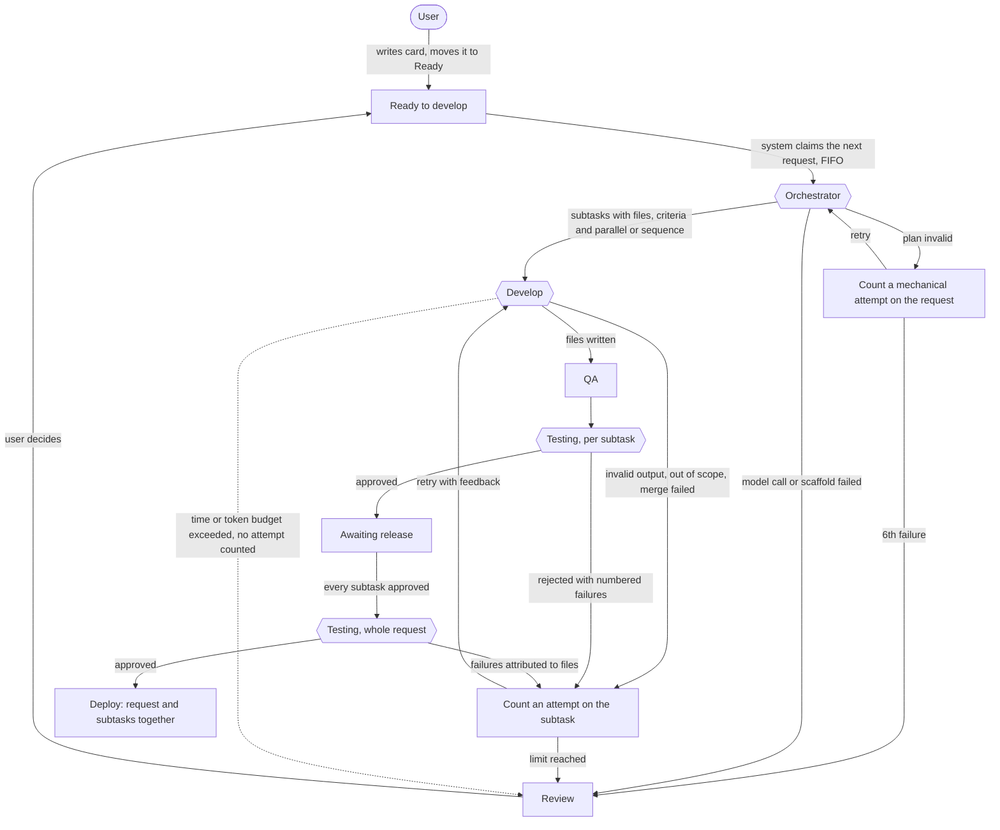
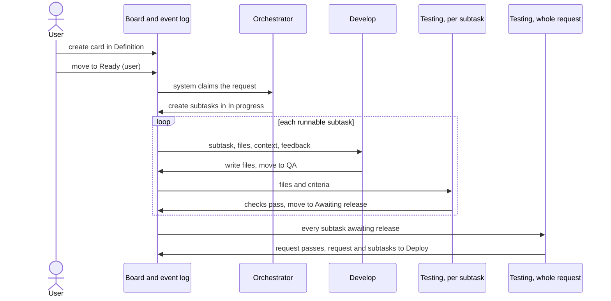

# Agent Team

A small Next.js app where a team of three AI agents works together on a user request, and every step is visible on a kanban board.

| Agent | Responsibility | Never does |
| --- | --- | --- |
| **Orchestrator** | Splits a request into subtasks with explicit acceptance criteria, files and a parallel or sequence flag. | Write code, judge code. |
| **Develop** | Implements one subtask against the target web project, only inside its declared file scope. | Plan, judge, touch files it was not given. |
| **Testing** | Judges Develop's output against the acceptance criteria and returns a numbered list of concrete failures. Also judges the whole request. | Write code, judge against its own taste. |

When two subtasks declare the same file, a merge step reconciles their edits before Testing judges the result.

This document explains what each agent receives, what it must return, what the system does with the answer, and how a failure is handled. How to run, configure and deploy the app is in [docs](docs/README.md).
## How the agents work together

The agents never call each other. A single loop in `claimAndOrchestrateRequest` hands the work from one to the next, and every handoff is a state change on the board with an event.



The loop, in order:

1. `claimNextReadyTask` moves the first `ready` request to `in_progress`.
2. The Orchestrator plans (retrying an invalid plan up to its limit).
3. A pass repeats: Develop runs the runnable subtasks, Testing reviews every subtask in QA, then request QA runs if every subtask is awaiting release.
4. After each pass the loop compares a snapshot of statuses and attempts. It stops when nothing changed or when no subtask is left in progress for Develop, so there are no infinite retries.

Only one request is in progress at a time, enforced by a unique partial index in the database, so two requests never write the same project at once. Other requests wait in FIFO order.

### Where the instructions live

The instructions of each agent are markdown files in `prompts/` (`orchestrator.md`, `develop.md`, `merge.md`, `testing-subtask.md`, `testing-request.md`). The code fills in the data of each run (titles, criteria, file contents) through `{{variable}}` placeholders, and the whole file is what the model receives. Editing a file changes the agent's behavior without touching the code that runs it.

### Where the files live

Each board points either to an absolute folder on disk or, when it has none, to a `storage:<board id>` location in Supabase Storage. The workspace reader and writer, the file lister and the browser probe are routed by that prefix, so the agents behave the same in both places. The disk writer refuses any path outside the project root. Before planning, the Orchestrator step creates the missing scaffold files (`package.json`, `tsconfig.json`, `vite.config.ts`, `index.html`, `main.tsx`, `App.tsx`).

### One happy-path run




## Orchestrator

**Responsibility.** Turn one request into a plan. It does not write code and does not judge it. It does not see the project files, only the request text.

**Input.** The prompt carries the request title and description, the parent task title and description, and fixed rules: reply with JSON only; the project is a React app whose scaffold already exists, so never plan a subtask that only creates scaffold files; the app entry is `App.tsx` at the project root; every later file grows from `App.tsx`, and the subtask that wires new files into it must run in sequence; set `runsInParallel` only when the subtask's files do not overlap with any other subtask.

**Output contract** (zod, `orchestration-plan.ts`):

| Field | Rule |
| --- | --- |
| `subtasks` | At least one. |
| `title`, `description` | Non-blank text. |
| `acceptanceCriteria` | At least one, each non-blank. |
| `files` | At least one, each inside the project root. |
| `runsInParallel` | Boolean. |
| Plan as a whole | No file may be a nested `App.tsx` such as `src/App.tsx`. The entry is `App.tsx` at the root. |

The error shown is the first schema issue. Nothing is created from an invalid plan. The "parallel only if files do not overlap" rule is in the prompt, not checked in code: overlapping files that run in parallel are handled by the merge step.

**What happens with the output.**

- Valid plan: the subtasks are saved in **In progress**, assigned to Develop, with 0 attempts, and one event per subtask (`Created from <parent id> by the orchestrator`). The request stays in progress.
- Invalid plan: a **mechanical** failed attempt is counted on the request with the schema error as feedback, and the plan is asked again. At the 6th attempt the request goes to Review.
- Any other failure (the model call failed, the board is missing, the scaffold could not be written): no attempt is counted and the request goes straight to Review with the reason, `reviewReason = orchestration`. The user can send it back to Ready once the cause is fixed.
- A request that already has subtasks is never split twice.

## Develop

**Responsibility.** Write the files of one subtask. It must stay inside the subtask's scope and must not plan or judge.

**Input.** One subtask at a time. The prompt carries, in this order:

1. The title, description and acceptance criteria.
2. Previous failures of this subtask, oldest first, numbered by attempt, the five most recent, with an instruction not to repeat them.
3. The feedback of the last review, to fix every point.
4. The exact files it may write and their current content (`(new file)` when absent).
5. **Read-only context**: other project files so it imports real exports. They are picked by `selectContextFiles`: the subtask's own files and the scaffold files (except `App.tsx`) are excluded, the rest are sorted by path and added while the total stays within a budget of 30,000 characters (lowered to the model's context window when that is smaller). A file that does not fit is skipped and later, smaller files can still fit.
6. The sibling subtasks with their files, so it refers to their real paths.
7. Reminders: a file with JSX ends in `.tsx`, and the reply is JSON only.

Only failures that returned the task to Develop appear in item 2 (a failed attempt, or a QA rejection). A request QA failure reaches Develop through the last feedback in item 3.

**Output contract.** `{ "files": [{ "path": string, "content": string }] }`, at least one file, with the full content of each file. Then `checkFileScope` rejects the output when:

- it has no files;
- it writes `App.ts` instead of `App.tsx`;
- a path is absolute, contains `..`, or is not one of the declared files. The feedback lists the allowed files and, when exactly one allowed file has the same name, suggests it.

**What happens with the output.**

1. If the run exceeded the time or token budget, it is stopped (see budgets below). This is checked before anything else, even when the reply was invalid.
2. Invalid JSON, a schema mismatch or a scope violation counts a **mechanical** failed attempt with the reason as feedback.
3. If QA already holds the configured number of tasks, the run fails with `QA is full: ...` and no attempt is counted. The subtask stays in progress and is picked up on a later pass.
4. **Shared files.** For each proposed file Develop compares the file on disk with the version it read at the start. If another subtask changed it meanwhile, the merge step sends the base, the file on disk and the proposed file to the LLM and expects `{ "content": string }`. A failed or malformed merge counts a mechanical failed attempt with the reason.
5. The files are written to the workspace and the subtask moves to **QA** (system).

**Hand-off and loop** (`runDevelopSubtasks`). Subtasks of a request that are in progress and assigned to Develop are batched:

- every subtask flagged `runsInParallel` runs together in one batch;
- if none is flagged, the first runnable subtask runs alone, in order.

After a batch, if any subtask failed without leaving the in-progress state or without adding an attempt, the batch stops there (stall detection). Otherwise the next batch is picked until nothing is runnable. A sequential subtask therefore starts only after the parallel ones are out of progress.

## Testing

Testing judges only against the acceptance criteria, in two levels. It does not write code and it does not use its own taste.

### Per subtask

`runTesting` reviews every subtask in QA, one after the other. For each, the checks run in this order and stop at the first level that fails:

| Order | Check | Kind of failure | Detail |
| --- | --- | --- | --- |
| 1 | **Deterministic** | mechanical | Every declared file exists. Every `.ts` or `.tsx` file parses (the TypeScript compiler reports syntax errors with the line). |
| 2 | **Type check** | mechanical | An in-memory TypeScript program is built from the project files and only the subtask's files are reported. It reports unresolved relative imports (with a suggested path), unknown names, missing exports, misspellings, wrong argument counts and type mismatches. Messages that only come from missing package typings are ignored. If the checker is unavailable or throws, this step reports nothing. |
| 3 | **LLM review** | substantive | The prompt has the criteria and the current content of the subtask's files. |

The review reply is validated with zod:

```json
{ "passed": true, "failures": [] }
{ "passed": false, "failures": [{ "criterion": "...", "file": "...", "line": 12, "message": "..." }] }
```

`passed: true` requires an empty list and `passed: false` requires at least one failure. If the review cannot be completed (provider error, invalid JSON, schema mismatch, unreadable files) the verdict is a **mechanical** failure `The review could not be completed: <reason>`, never a silent pass.

Feedback is a numbered list. A failed check reads `file:line: message`; a review failure reads `criterion (file:line): message`. The schema forces a criterion and a file for every failure, so feedback is never a vague "looks wrong".

**What happens with the verdict.** A pass moves the subtask from QA to **Awaiting release**, not to Deploy. A failure adds one attempt, stores the feedback and moves it back to **In progress**, or to **Review** when the limit for its kind is reached.

### Per request

When every subtask of a request is awaiting release, the request moves to **QA** (`Every subtask is awaiting release`) and is judged as a whole.

- **Browser check enabled** (`BROWSER_CHECK_ENABLED=true`). The Playwright probe installs the project dependencies if declared ones are missing from `node_modules` (5 minute limit), starts the project's dev server on a free port (60 second limit to answer), opens it in headless Chromium, reads the text of the page body (first 4,000 characters) and collects console and page errors, then stops the server. For a project stored in Supabase the files are first copied to a temporary folder. The LLM receives the request, every subtask with its criteria, the visible text with the console errors, and the project files as read-only context (same budget as Develop). The reply has `passed` and `failures`, each with `criterion`, `message` and a `file` or `null`.
- **Browser check disabled** (for example on Vercel, where a browser cannot run). The request passes without reviewing the running app, because the code was already audited per subtask.
- Either way the Deploy event records what was reviewed. Disabled: `The browser check is disabled, so the running app was not reviewed.` Enabled: the number of characters of visible text, the console errors, the subtask and criteria counts and the first 200 characters of the page text.
- If the app cannot start, the probe fails or the review cannot be completed, the request fails QA (`The app starts` or `Request review`) with no file, which sends every subtask back.

A pass moves the request and all its subtasks to **Deploy** together (`Request QA passed. <evidence>` and `Released with its request`). Here "Deploy" means Testing approved the work. Nothing is published to a host.

**Failure attribution.** Each failure is attributed to the subtask that declares its file. Only those subtasks go back to In progress with their own numbered failures and one more attempt, and the request returns to In progress. A failure without a file, or with a file no subtask declares, goes to every subtask. A subtask whose attempts reach the `maxAttempts` setting (default 3) goes to Review.

A separate, user-confirmed browser check also exists for a task sitting in QA. The automatic loop does not use it.

## Failures, attempts and budgets

### Failure kinds

The kind is decided by where the failure came from, never by reading its text.

| Kind | Examples | Limit before Review |
| --- | --- | --- |
| **Mechanical** | Invalid plan, invalid JSON or schema, write outside scope, failed merge, missing file, syntax or type error, an incomplete review. | 6 attempts |
| **Substantive** | The LLM review judged an acceptance criterion unmet. | 3 attempts |

The limits are constants (`maxAttemptsPerTask` = 3, `maxMechanicalAttemptsPerTask` = 6). The attempt counter is shared between kinds. A failure at request QA is always judged by the `maxAttempts` setting (default 3), not by kind.

### What does not count as an attempt

| Situation | Effect |
| --- | --- |
| The model provider is unreachable (the Ollama adapter reports this as unavailable) | Develop stops without counting an attempt and the subtask stays in progress. |
| QA is full | Develop stops without counting an attempt and tries again on a later pass. |
| A time or token budget is exceeded | The task goes to Review, no attempt is counted. |
| The Orchestrator cannot call the model, or the scaffold fails | The request goes straight to Review with `reviewReason = orchestration`, no attempt. |

A Gemini request that fails (for example with an HTTP error) is not marked as unavailable. In Develop it counts as a mechanical failed attempt.

### Budgets

Develop measures each run against two soft limits from Settings: minutes (default 15) and tokens (default 50,000). When either is exceeded, `stopTaskForBudget` moves the subtask to Review with the reason (`Stopped after N min, over the 15 min budget`, or the token equivalent), `reviewReason = budget`. Attempts do not change, because the system did not judge the work. While it waits in Review, the system does not run it again. Budgets are checked only on Develop runs.

## Review: the user decides

A card lands in Review after its attempt limit, after a budget stop, or when the Orchestrator fails. The system never moves a card out of Review. The user can:

| Decision | Effect |
| --- | --- |
| **Send to Ready** | Attempts reset to zero, feedback kept. A subtask goes straight back to work in its request; a request goes back to the queue and is claimed again. |
| **Continue** | Allowed only for `reviewReason = budget`. Back to In progress with the same attempts and a fresh budget. Each continuation is a new decision. |
| **Delete** | Removes the card. Allowed only in Definition and Review. |

## Observability

- **Agent panel.** One card per agent with a state and a last message. The Orchestrator is `working` (`Splitting "<title>" into subtasks`), Develop is `working` (`Writing "<title>"`), Testing is `reviewing` (`Reviewing "<title>"`). Each goes back to `idle` when its run ends, even if it failed (`Waiting for a request in Ready`, `Waiting for a subtask in progress`, `Waiting for a subtask in QA`).
- **Live status.** While a model call streams, the card shows `Writing`, `Splitting` or `Reviewing` plus the characters received so far, updated every 500 characters, and cleared when the run ends.
- **Event log.** Every transition is an event with actor, from, to and reason: the plan, each claim, every failed attempt with its feedback, every pass, budget stops, review decisions and the Deploy evidence. The board and the team page poll every 2 seconds.
- **Conflicts.** Every write checks the status it expects. A stale write is rejected with `The task changed while this request was processed. Try again.` instead of overwriting.

## Walkthrough: a weather page

The request: title `A weather page for Las Palmas de Gran Canaria`, description `Show today's weather and the next three days.` The plan below is **illustrative**, written to show the mechanics. It is not real model output.

**1. User.** Creates the card in Definition, moves it to Ready. Nothing else is done by hand.

**2. Orchestrator.** The system claims the request and writes the missing scaffold files. The Orchestrator returns, for example:

| # | Subtask | Files | Parallel | Acceptance criteria |
| --- | --- | --- | --- | --- |
| 1 | Forecast data | `forecast.ts` | yes | Exports a `Forecast` type with day, temperature in Celsius and condition. Exports today's forecast and three upcoming days for Las Palmas de Gran Canaria. |
| 2 | Forecast card | `ForecastCard.tsx` | yes | Renders day, temperature with its unit and condition from props. |
| 3 | Weather page | `WeatherPage.tsx`, `App.tsx` | no | Page title names Las Palmas de Gran Canaria. Shows one card for today and three for the next days. `App.tsx` renders the page. |

Schema valid, no nested `App.tsx`. Three subtasks are created in In progress with 0 attempts and three creation events.

**3. Develop, first batch.** Subtasks 1 and 2 are flagged parallel, so they run together. Each prompt carries its criteria, its file (`(new file)`), read-only context, and the sibling it can import by path. Both replies are valid and inside scope, so both are written and both move to QA. Subtask 3 is not parallel and was not in the batch.

**4. Develop, second batch.** Subtask 3 runs alone. It reads `forecast.ts` and `ForecastCard.tsx` as context and imports their real exports. QA already holds two tasks (the default limit), so the run ends with `QA is full: 2 of 2 tasks are already in qa`. No attempt is counted.

**5. Testing, subtasks 1 and 2.** Both files exist and parse, and the type check finds nothing. The LLM review passes subtask 1. For subtask 2 it fails:

```
1. Renders day, temperature with its unit and condition from props (ForecastCard.tsx:12): the temperature is rendered without a unit.
```

Subtask 1 moves to Awaiting release. Subtask 2 is a substantive failure: it returns to In progress with attempt 1 of 3 and that feedback.

**6. The retry.** The next pass runs subtask 2 (parallel flag, so its own batch) and then subtask 3. The prompt for subtask 2 now lists `Attempt 1: 1. Renders day, temperature ...` under previous failures and repeats it as the last feedback. The new file renders `{temperature} °C` and passes review, so it moves to Awaiting release. Subtask 3, now with room in QA, writes `WeatherPage.tsx` and `App.tsx`, passes the checks and moves to Awaiting release.

**7. Request QA.** Every subtask is awaiting release, so the request moves to QA. With the browser check on, Playwright starts the app, reads the visible text (title, four cards, `°C`) with no console errors, and the LLM reviews it against the request and all criteria. It passes. The request and the three subtasks move to Deploy, and the event reads `Request QA passed. Reviewed the running app: ...`.

If step 7 had failed with `{ "file": "WeatherPage.tsx", ... }`, only subtask 3, which declares that file, would have gone back to In progress with that failure and one more attempt.


## Known limits

- Testing reads code and the text of the rendered page. It does not see network data or interaction results, so a field that is rendered but never fetched can pass review.
- Develop returns whole files, and the shared-file merge is done by the LLM over whole files, not by a mechanical three-way diff. It is the most likely step to need a retry when two subtasks edit the same file.
- Without the browser check, the request QA adds no new judgment on top of the per-subtask audit.
- The type check reports a fixed list of error kinds on the subtask's own files, against the project files as a virtual program, not against installed packages.
- The attempt counter is shared between kinds: a task with three mechanical failures that then fails on substance goes to Review at once, because its attempts already reached the substantive limit.
- **Continue** on a budget-stopped subtask is refused while its request is in progress: `transitionTask` counts the in-progress request as the task already in progress, and the message is `Another task is already in progress`. Send to Ready is the working path for a subtask.
- The attempt limits 3 and 6 are constants. The `maxAttempts` setting is applied only when request QA sends a subtask back.
- The "parallel only if files do not overlap" rule is a prompt instruction. The code trusts the flag.

How to run, configure and deploy the app is in [docs](docs/README.md).
